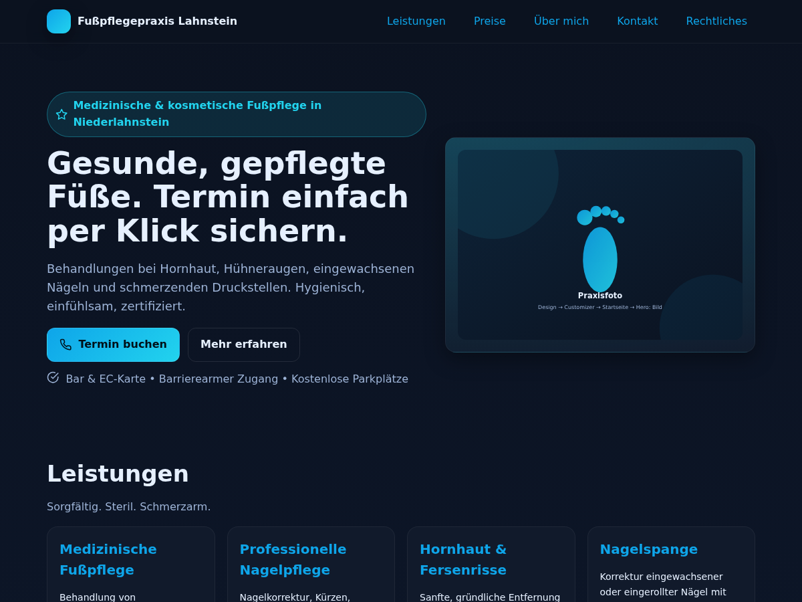
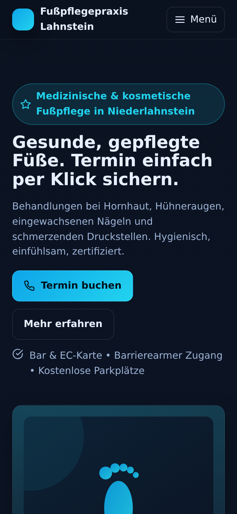
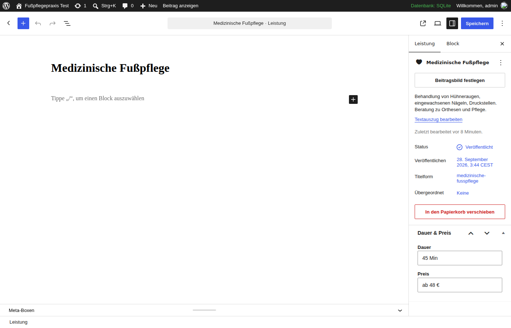

# Fußpflege One-Pager → WordPress-Theme

Lern- und Portfolio-Projekt: Das statische HTML-Template aus [`static-html/`](static-html/) wurde in ein
vollwertiges, klassisches WordPress-Theme umgebaut → [`wp-content/themes/fusspflege/`](wp-content/themes/fusspflege/).
Genau die Art Job („HTML → WordPress“), die auf Upwork ständig ausgeschrieben wird.

| Startseite | Mobil | Backend (Leistung mit Meta-Box) |
|---|---|---|
|  |  |  |

## Was das Theme kann

- **Customizer** (*Design → Customizer → Fußpflege-Theme*): Praxisname, Adresse, Telefon, Öffnungszeiten, alle Texte und Bilder – kein Code nötig
- **Inhaltstyp „Leistungen“** mit Meta-Box Dauer/Preis → speist Karten **und** Preistabelle aus einer Quelle
- **Kontaktformular ohne Plugin**: Nonce (CSRF), Honeypot (Spam), Rate-Limit, DSGVO-Einwilligung, `wp_mail()` mit Reply-To
- **Rechtliches**: Impressum/Datenschutz sind normale Seiten, im Customizer zugewiesen, auf der Startseite eingeklappt + im Footer verlinkt
- **DSGVO-freundlich**: keine Google Fonts, keine Karten-Embeds, keine CDNs, keine Cookies
- **WordPress-Standard**: Template-Hierarchie, `wp_enqueue_*`, Escaping überall, übersetzbar (Text Domain `fusspflege`), Menü-Positionen, Custom Logo, Skip-Link, JSON-LD (LocalBusiness), Admin-Bar-Offset

## Schnellstart

### A) Docker (Ubuntu, Raspberry Pi – arm64-Images vorhanden)

```bash
git clone https://github.com/xDennxD/af-fu-.git && cd af-fu-
bin/setup.sh
```

→ Website <http://localhost:8080> · Backend <http://localhost:8080/wp-admin> · Login `admin` / `admin`

### B) Ohne Docker – nur PHP (SQLite statt MySQL)

```bash
sudo apt install php-cli php-sqlite3 php-mbstring php-xml php-gd php-curl php-zip curl unzip
bin/local-sqlite.sh
```

→ <http://localhost:8000>

Beide Skripte installieren WordPress, aktivieren das Theme und legen Beispielinhalte an
(4 Leistungen, Impressum, Datenschutz, Praxisdaten). Sie sind mehrfach ausführbar.
Das Theme ist per Bind-Mount/Symlink eingebunden: Datei speichern → Browser neu laden.

## Inhalte pflegen (so erklärst du es später dem Kunden)

| Was | Wo |
|---|---|
| Praxisdaten, Texte, Bilder, Hinweise | Design → Customizer → **Fußpflege-Theme** |
| Leistungen & Preise | **Leistungen** → Neue Leistung (Dauer/Preis in der Seitenleiste, Reihenfolge über „Reihenfolge“) |
| Impressum / Datenschutz | Seiten anlegen → Customizer → **Rechtliches & Kontaktformular** zuweisen |
| Menü | Design → Menüs → Position „Hauptnavigation“ (ohne Menü: automatische Ankerlinks) |
| Logo, Titel, Untertitel (= Meta-Description) | Customizer → Website-Informationen |
| Empfänger des Kontaktformulars | Customizer → Rechtliches & Kontaktformular |

## Lernen

1. [`docs/01-lernpfad.md`](docs/01-lernpfad.md) – 6–8 Wochen bis „Upwork-tauglich“, mit Übungen in diesem Repo
2. [`docs/02-theme-anatomie.md`](docs/02-theme-anatomie.md) – jede Datei erklärt, die 5 Kernkonzepte, typische Fehler
3. [`docs/03-upwork.md`](docs/03-upwork.md) – Profil, Portfolio-Text, Proposal-Vorlage, Preise, Deutschland-Spezifisches

## Struktur

```
.
├── bin/
│   ├── setup.sh              # Docker: installieren, Theme aktivieren, Beispielinhalte
│   └── local-sqlite.sh       # dasselbe ohne Docker (PHP + SQLite)
├── docker-compose.yml        # MariaDB + WordPress + WP-CLI
├── docs/                     # Lernpfad, Theme-Anatomie, Upwork-Guide, Screenshots
├── static-html/              # das Original-Template (Ausgangspunkt)
└── wp-content/themes/fusspflege/
    ├── style.css             # Theme-Header (Pflicht)
    ├── functions.php         # Setup + Includes
    ├── inc/                  # customizer, cpt-leistungen, kontaktformular, template-tags
    ├── template-parts/       # hero, leistungen, preise, ueber, kontakt, rechtliches
    ├── assets/               # css, js, img (Platzhalter-SVGs)
    └── front-page.php, index.php, single.php, page.php, 404.php, header.php, footer.php
```

## Nützliche Befehle

```bash
docker compose run --rm cli theme list                       # WP-CLI im Container
docker compose run --rm cli post list --post_type=leistung
docker compose logs -f wordpress                              # Apache/PHP-Log
docker compose exec wordpress tail -f wp-content/debug.log    # WP_DEBUG-Log
docker compose down -v                                        # alles löschen (inkl. DB)
```

Ohne Docker: `php wp/wp-cli.phar --path=wp <befehl>`

## Code-Qualität

```bash
composer install     # PHP_CodeSniffer + WordPress Coding Standards (nur Dev)
composer lint        # prüft das Theme gegen den kompletten "WordPress"-Standard (Stil + Sicherheit)
composer lint:fix    # behebt automatisch fixbare Verstöße
```

Der Standard umfasst u. a. Escaping, Nonce-Prüfung, Sanitizing, Präfixe und Text Domain –
genau die Punkte, die Kunden und Theme-Reviewer prüfen. Aktueller Stand: 0 Fehler, 0 Warnungen.

## Vor einem echten Livegang

- `Author` in `style.css` und die Beispiel-Praxisdaten ersetzen
- Impressum/Datenschutz sind **Muster** – juristisch prüfen lassen
- E-Mail-Versand auf dem Hoster testen; bei Problemen Plugin *WP Mail SMTP*
- Admin-Passwort ändern, `WP_DEBUG` aus, Backups einrichten
